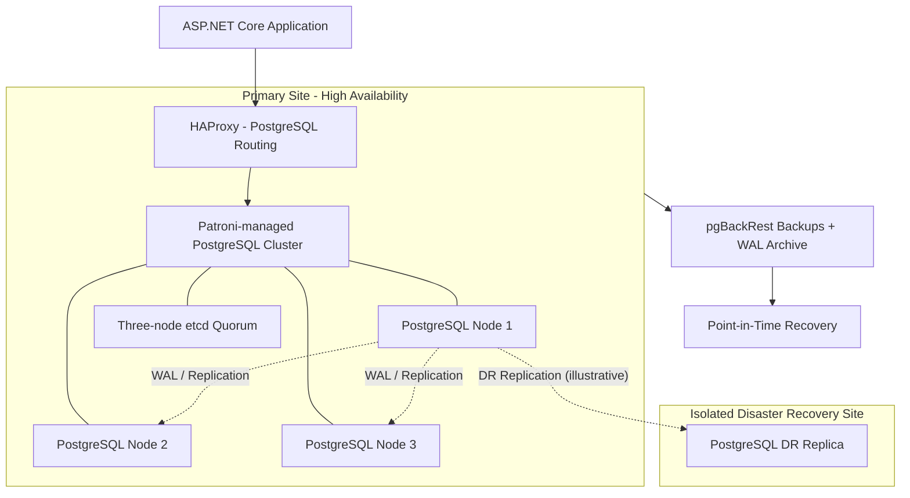

# PostgreSQL High Availability & Disaster Recovery

### Build, Test, Fail Over, and Recover Production-Style PostgreSQL Systems

> **PostgreSQL replication is not the same as high availability, and high availability is not the same as disaster recovery.** Learn what happens when a primary database fails, an application loses connectivity, or an entire site becomes unavailable.

🎓 **[Enroll in PostgreSQL High Availability & Disaster Recovery on Udemy](https://www.udemy.com/course/postgresql-ha-drc/?referralCode=FC3F96BA56804D73E957)**

## About This Course

This hands-on course explores how to design, build, test, and recover **PostgreSQL 18 High Availability (HA) and Disaster Recovery (DR)** environments. Rather than stopping at a working replication setup, it examines how PostgreSQL systems behave during real failure scenarios and how to validate recovery from the application perspective.

You'll build a production-style lab using **PostgreSQL streaming replication, Patroni, etcd, HAProxy, pgBackRest, WAL archiving, and Point-in-Time Recovery (PITR)**. You'll then deliberately introduce failures, observe the results, measure recovery behavior, and restore service.

The course includes a real **ASP.NET Core application** that continuously interacts with PostgreSQL, helping demonstrate the difference between a successful database failover and actual application recovery.

**Course details:** English · Intermediate · 8 sections · 64 lectures · approximately 7 hours 38 minutes.

## What You'll Learn

- Configure and troubleshoot **PostgreSQL physical streaming replication**, WAL flow, standby synchronization, and replication lag.
- Perform **manual failover and switchover**, promote a standby, and recover or rejoin a former primary while understanding split-brain risks.
- Build a **PostgreSQL HA cluster with Patroni and a three-node etcd quorum**, including leader election and automatic failover.
- Route application connections through **HAProxy**, then test failover using a live **ASP.NET Core API** workload.
- Implement PostgreSQL backups and **WAL archiving with pgBackRest**, and perform **Point-in-Time Recovery (PITR)** following data loss.
- Design a separate **Disaster Recovery site**, simulate a complete primary-site outage, promote the DR database, and cut over the application.
- Measure **Recovery Point Objective (RPO)**, **Recovery Time Objective (RTO)**, replication lag, application downtime, and potential data loss.

## Technologies Covered

| Component | Role in the Lab |
| --- | --- |
| **PostgreSQL 18** | Primary database, standby replicas, replication, and recovery |
| **Patroni** | HA orchestration, leader management, and failover |
| **etcd** | Distributed configuration store and leader-election coordination |
| **HAProxy** | Database connection routing to the writable primary |
| **pgBackRest** | Backups and restore workflows |
| **WAL Archiving / PITR** | Recovering database state to a selected point in time |
| **ASP.NET Core / Npgsql** | Application workload and failover continuity validation |
| **Linux & Virtual Machines** | Practical lab deployment and network separation |

## High Availability and Disaster Recovery Architecture

The diagram illustrates the major learning components. It is a conceptual overview rather than a drop-in production reference design.

The course also covers how replica roles change after failover, why quorum matters, and why **automatic HA failover** and **site-level DR promotion** are separate operational procedures. Exact data paths, DR promotion, fencing, and routing must be validated against a deployment's own architecture.

## Course Curriculum

| Section | Topics |
| --- | --- |
| **1. HA & DR Fundamentals** | Architecture, RPO, RTO, failover, switchover, and failback |
| **2. Build the Virtual Machine Lab** | Private networks, PostgreSQL nodes, HAProxy, DR server, and ASP.NET Core client |
| **3. Streaming Replication** | WAL, `pg_basebackup`, replication health, and lag measurement |
| **4. Manual Failover** | Primary failure simulation, standby promotion, rejoining nodes, and split-brain avoidance |
| **5. Patroni and etcd** | Quorum, leader election, cluster setup, and controlled switchover |
| **6. Automatic Failover and Application Testing** | HAProxy, ASP.NET Core transaction workload, outage measurement, and node recovery |
| **7. Backup and Point-in-Time Recovery** | pgBackRest, WAL archiving, backup verification, data-loss simulation, and PITR |
| **8. Disaster Recovery and Failback** | Isolated DR site, site outage, DR promotion, application cutover, and recovery planning |

## Practical Failure Scenarios

Instead of treating database availability as a configuration checkbox, the labs focus on failure behavior. You'll stop PostgreSQL primary services, promote standby databases, recover failed nodes, test loss of an etcd member, and run application transactions during failover. You'll also simulate accidental data deletion, recover with PITR, and evaluate what happens when the entire primary site is lost.

These exercises reinforce an important production principle: **a healthy replica does not, by itself, prove that an application can meet its recovery objectives.**

## Who Should Take This Course?

This course is designed for **PostgreSQL DBAs, database administrators, DevOps engineers, Site Reliability Engineers (SREs), platform engineers, infrastructure engineers, and backend engineers** responsible for reliable PostgreSQL services.

Students should already be comfortable with basic **PostgreSQL administration, SQL, Linux commands, and TCP/IP networking**. The emphasis is practical HA/DR engineering, rather than an introduction to relational databases.

## Why This Course?

Many PostgreSQL deployments begin with streaming replication, but production reliability requires decisions about failure detection, orchestration, cluster quorum, application reconnect behavior, backup integrity, DR isolation, and recovery objectives. This course brings these topics together in one guided lab environment and validates them through realistic failure and recovery scenarios.

**Build it. Break it. Observe it. Fail over. Recover it.**

## Start Learning

Ready to move beyond PostgreSQL replication and build practical high availability and disaster recovery skills?

### 🎓 [View the Complete PostgreSQL HA & DR Course on Udemy](https://www.udemy.com/course/postgresql-ha-drc/?referralCode=FC3F96BA56804D73E957)

**Instructor:** Agus Kurniawan  
**Course language:** English  
**Platform:** Udemy

Explore [other courses by Agus Kurniawan on Udemy](https://www.udemy.com/user/agus-kurniawan/).

---

**About this repository:** This repository provides course information and an overview of the learning objectives and architecture. **The full lessons, guided hands-on labs, and course materials are available through Udemy; this repository is not presented as a public source-code download.**

